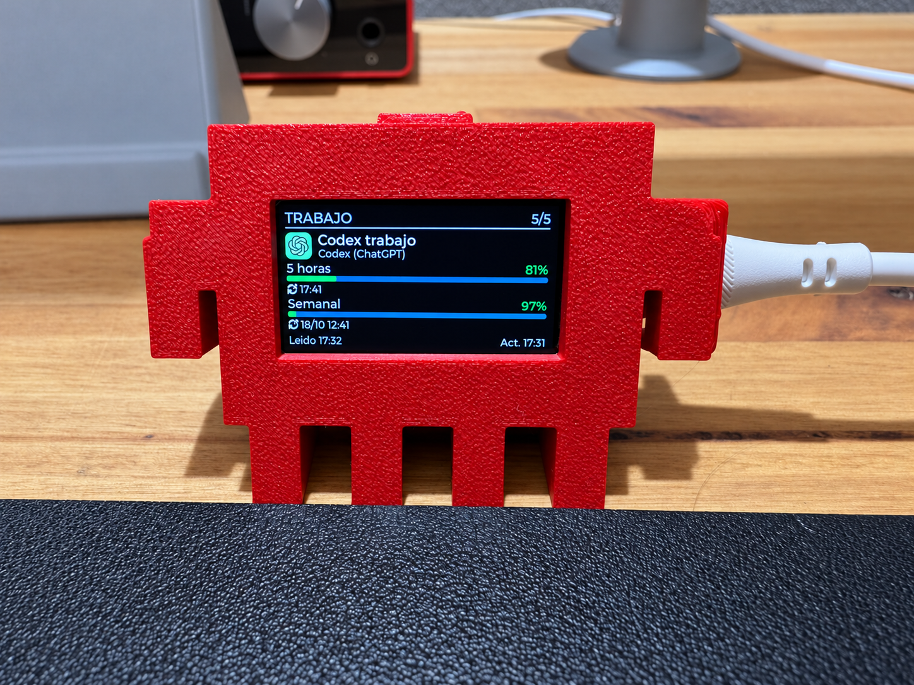
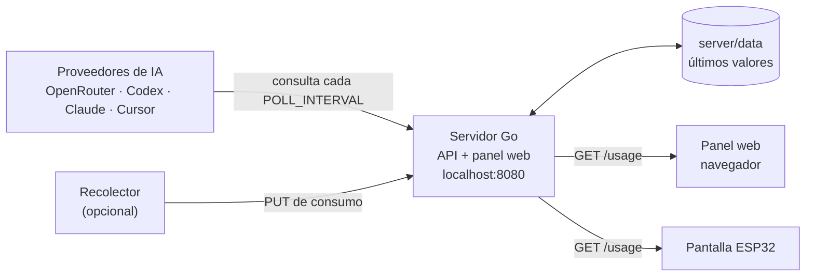

# AI Quota Monitor

[English](README.md) · **Español**

[](https://github.com/a-bianchi/ai-quota-monitor/actions/workflows/go.yml)
[](LICENSE)



*El display de escritorio terminado: el ESP32 en su [carcasa impresa en 3D](enclosure/README.es.md), mostrando los cupos de una cuenta.*

Monitor autohospedado de los cupos de tus servicios de IA. Una API en Go consulta a cada proveedor, guarda el último valor y lo muestra en un panel web y en un display físico ESP32 de escritorio. Separa las cuentas **personales** de las **laborales**.


*Tablero del panel con las seis cuentas ficticias del modo de ejemplo (etiqueta `EJEMPLO`).*

## Qué problema resuelve

Cada servicio de IA muestra su consumo en un lugar distinto: una ventana de 5 horas acá, un límite semanal allá, un saldo prepago en otra página. Este proyecto junta esos números en un solo lugar, con el mismo formato y sin tener que abrir cada dashboard.

## Funcionalidades implementadas

- **API JSON** con un contrato único de cupos: unidad, usado, límite, renovación, estado de la cuenta y nivel de uso (`usageLevel`).
- **Panel web** incluido en el mismo binario: tablero, vista previa de la pantalla del ESP32 y configuración de proveedores. Español e inglés.
- **Cuentas personales y laborales** separadas, con filtro `?scope=personal|work`.
- **Modo de ejemplo** con datos ficticios, para probar sin ninguna cuenta real.
- **Consulta periódica** a los proveedores y aviso de datos viejos o de sesiones vencidas.
- **Credenciales en el servidor**: sesiones de Codex y Claude por cuenta, y keys cargadas desde el panel cifradas con AES-256-GCM.
- **Ingestión** opcional de datos enviados por un recolector externo.
- **Despliegue** con un binario Go o con Docker Compose.

## Proveedores

| Servicio | Estado | Cómo se conecta |
|---|---|---|
| OpenRouter | Implementado | Management key; API oficial de créditos |
| Codex (ChatGPT) | Implementado | Login por código de dispositivo, mediante Codex App Server |
| Cursor | Experimental | Cookie de sesión; endpoint no documentado del dashboard |
| Claude Pro/Max | Experimental; [no permitido por los términos de Anthropic](docs/providers/claude-subscription.es.md) | Login OAuth; endpoint de uso no documentado |
| Kiro | Evaluado, sin implementar | Solo existe como cuenta de ejemplo |
| ChatGPT (chat normal) | No integrado | No se confirmó un contador completo por API |

Los clientes tienen tests contra servidores simulados. La documentación de cada proveedor indica qué se validó con cuentas reales y qué no: ver [proveedores](docs/providers/README.es.md) y la [guía para conectarlos](docs/providers/connect.es.md).

## Capturas

Tomadas del panel real con datos de demostración.

| Vista previa del display | Configuración |
|---|---|
|  |  |
| Lo que mostraría la pantalla de 172 × 320 px, con las cuentas de ejemplo. | Configuración de ejemplo, sin ninguna sesión iniciada ni credencial cargada. |

## Inicio rápido

Requisitos: Git y Docker con Compose v2. Desde la raíz del repo:

```sh
cp server/.env.example server/.env
openssl rand -hex 32
```

Pegá el resultado en `DEVICE_TOKEN` dentro de `server/.env`. Después:

```sh
make docker-up
curl http://localhost:8080/ping
```

Para leer los datos, reemplazá el marcador por tu token:

```sh
curl -H 'Authorization: Bearer TU_DEVICE_TOKEN' \
  'http://localhost:8080/usage?scope=personal'
```

Arranca en modo de ejemplo, con seis cuentas ficticias. Los pasos siguientes:

- **Sin Docker**: `make run`, con Go 1.22 o posterior. Ver [instalación local](docs/local-setup.es.md).
- **Panel web**: creá el usuario con `make panel-password` y abrí <http://localhost:8080/>. Ver [panel web](docs/panel.es.md).
- **Cuentas reales**: poné `CONFIG_NAME=config.live.json` y seguí la [guía de proveedores](docs/providers/connect.es.md).

## Cómo funciona



Un solo proceso Go consulta a los proveedores con un temporizador, guarda el último valor de cada cuenta y sirve la API y el panel en el mismo puerto. El panel y el display solo leen lo guardado: abrirlos nunca dispara una consulta a un proveedor. Más detalle en [arquitectura](docs/architecture.es.md).

## Hardware

El display objetivo es una **Waveshare ESP32-C6-LCD-1.47**: pantalla de 172 × 320 px, Wi-Fi de 2,4 GHz y alimentación por USB-C. El firmware está en [`firmware/esp32-c6-lcd-1.47/`](firmware/esp32-c6-lcd-1.47/README.es.md) y compila con Arduino IDE; funciona en la placa física. Una [carcasa](enclosure/README.es.md) para imprimir en 3D la sostiene sobre el escritorio. La pantalla puede estar en español o en inglés, el botón BOOT pasa de página y el LED RGB se pone verde, naranja o rojo según el nivel de uso. El servidor y el panel funcionan sin la placa. Ver [hardware](docs/hardware.es.md) para la placa exacta y dónde comprarla, la [guía del firmware](docs/firmware.es.md) para compilarlo y cargarlo, y [carcasa](enclosure/README.es.md).

## Estado del proyecto

Funciona hoy: servidor, API, panel web, modo de ejemplo, Docker Compose, los clientes de OpenRouter, Codex, Cursor y Claude, el firmware del ESP32 en la placa física, la carcasa impresa en 3D y el despliegue en Coolify.

Pendiente:

- Integración con Kiro: evaluada, sin implementar.
- Validación con cuentas reales de las integraciones experimentales.
- Firmware por HTTPS con un certificado real.

El detalle está en el [roadmap](docs/roadmap.es.md).

## Documentación

El [índice de documentación](docs/README.es.md) lista todos los temas. Los más usados:

- [Instalación local](docs/local-setup.es.md) y [configuración](docs/configuration.es.md)
- [Despliegue con Docker, homelab y Coolify](docs/deployment.es.md)
- [Panel web](docs/panel.es.md)
- [Proveedores](docs/providers/connect.es.md)
- [Referencia de la API](docs/api.es.md)
- [Solución de problemas](docs/troubleshooting.es.md)

## Contribuir

Los cambios son bienvenidos. [CONTRIBUTING.es.md](CONTRIBUTING.es.md) explica cómo ejecutar el proyecto, correr las pruebas y agregar un proveedor. No incluyas cookies, sesiones, keys ni datos de trabajo en commits o issues.

## Licencia

[MIT](LICENSE). Proyecto no afiliado a los fabricantes ni a los proveedores mencionados.
