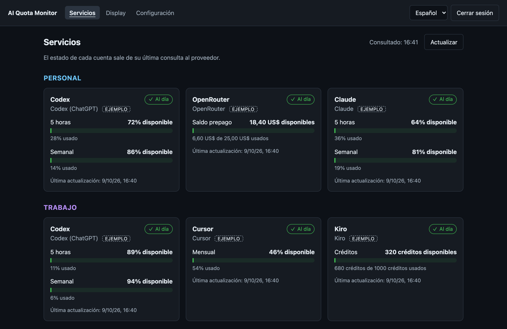
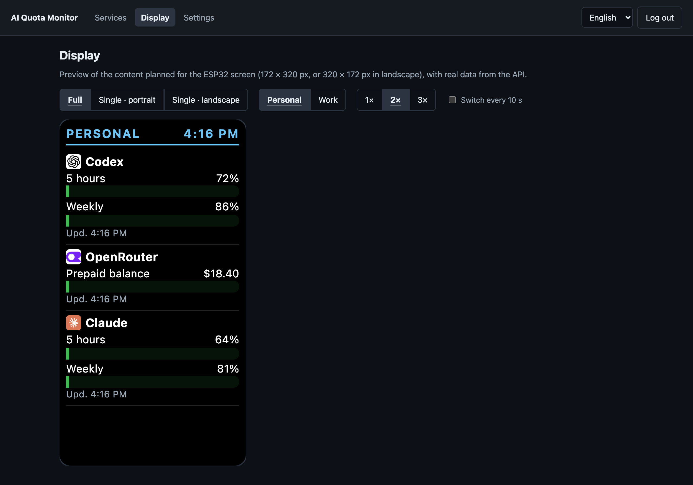
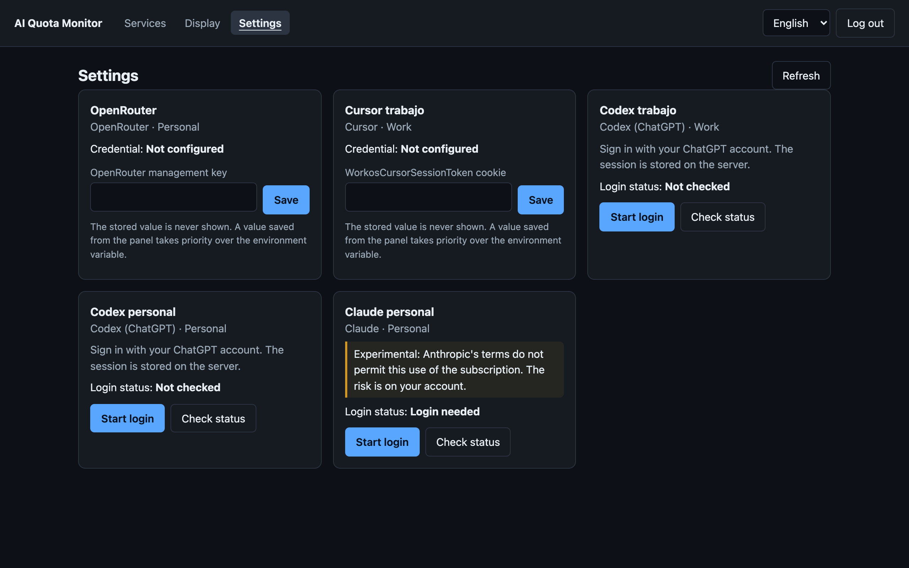
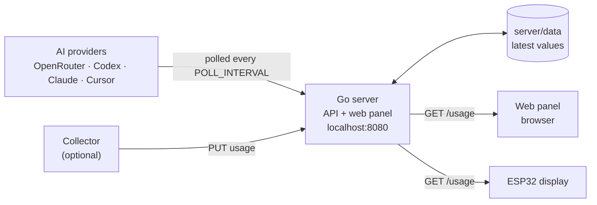

# AI Quota Monitor

**English** · [Español](README.es.md)

[](https://github.com/a-bianchi/ai-quota-monitor/actions/workflows/go.yml)
[](LICENSE)

Self-hosted monitor for the quotas of your AI services. A Go API polls each provider, stores the latest value and shows it in a web panel and on a physical ESP32 desk display. It keeps **personal** and **work** accounts apart.



*Panel dashboard with the six fictitious accounts of example mode (`EJEMPLO` tag). Screenshots show the Spanish interface; the panel is also available in English.*

## What problem it solves

Every AI service shows its usage somewhere different: a 5-hour window here, a weekly limit there, a prepaid balance on another page. This project puts those numbers in one place, in the same format, without opening each dashboard.

## Implemented features

- **JSON API** with a single quota contract: unit, used, limit, reset time, account status and usage level (`usageLevel`).
- **Web panel** embedded in the same binary: dashboard, preview of the ESP32 screen and provider settings. Spanish and English.
- **Personal and work accounts** kept apart, with a `?scope=personal|work` filter.
- **Example mode** with fictitious data, to try it without any real account.
- **Periodic polling** of the providers, flagging stale data and expired sessions.
- **Credentials on the server**: per-account Codex and Claude sessions, and keys loaded from the panel encrypted with AES-256-GCM.
- Optional **ingestion** of data sent by an external collector.
- **Deployment** as a Go binary or with Docker Compose.

## Providers

| Service | Status | How it connects |
|---|---|---|
| OpenRouter | Implemented | Management key; official credits API |
| Codex (ChatGPT) | Implemented | Device-code login through Codex App Server |
| Cursor | Experimental | Session cookie; undocumented dashboard endpoint |
| Claude Pro/Max | Experimental; [not permitted by Anthropic's terms](docs/providers/claude-subscription.md) | OAuth login; undocumented usage endpoint |
| Kiro | Evaluated, not implemented | Exists only as an example account |
| ChatGPT (regular chat) | Not integrated | No complete counter was confirmed through an API |

The clients have tests against simulated servers. Each provider's documentation states what was validated with real accounts and what was not: see [providers](docs/providers/README.md) and the [guide to connect them](docs/providers/connect.md).

## Screenshots

Taken from the real panel with demo data.

| Display preview | Settings |
|---|---|
|  |  |
| What the 172 × 320 px screen would show, with the example accounts. | Example configuration, with no session started and no credential loaded. |

## Quick start

Requirements: Git and Docker with Compose v2. From the repo root:

```sh
cp server/.env.example server/.env
openssl rand -hex 32
```

Paste the result into `DEVICE_TOKEN` in `server/.env`. Then:

```sh
make docker-up
curl http://localhost:8080/ping
```

To read the data, replace the placeholder with your token:

```sh
curl -H 'Authorization: Bearer YOUR_DEVICE_TOKEN' \
  'http://localhost:8080/usage?scope=personal'
```

It starts in example mode, with six fictitious accounts. Next steps:

- **Without Docker**: `make run`, with Go 1.22 or later. See [local setup](docs/local-setup.md).
- **Web panel**: create the user with `make panel-password` and open <http://localhost:8080/>. See [web panel](docs/panel.md).
- **Real accounts**: set `CONFIG_NAME=config.live.json` and follow the [provider guide](docs/providers/connect.md).

## How it works



A single Go process polls the providers on a timer, stores the latest value of each account and serves the API and the panel on the same port. The panel and the display only read what is stored: opening them never triggers a request to a provider. More detail in [architecture](docs/architecture.md).

## Hardware

The target display is a **Waveshare ESP32-C6-LCD-1.47**: 172 × 320 px screen, 2.4 GHz Wi-Fi and USB-C power. The firmware is in [`firmware/esp32-c6-lcd-1.47/`](firmware/esp32-c6-lcd-1.47/) and compiles with Arduino IDE; it runs on the physical board. A 3D-printable [enclosure](enclosure/README.md) holds it on a desk. The server and the panel work without the board. See [hardware](docs/hardware.md) for the exact board and where to buy it, the [firmware guide](docs/firmware.md) to build and flash it, and [enclosure](enclosure/README.md).

## Project status

Working today: server, API, web panel, example mode, Docker Compose, the OpenRouter, Codex, Cursor and Claude clients, the ESP32 firmware on the physical board, the 3D-printed enclosure and the Coolify deployment.

Pending:

- Kiro integration: evaluated, not implemented.
- Validation of the experimental integrations with real accounts.
- Firmware over HTTPS with a real certificate.

The details are in the [roadmap](docs/roadmap.md).

## Documentation

The [documentation index](docs/README.md) lists every topic. The most used:

- [Local setup](docs/local-setup.md) and [configuration](docs/configuration.md)
- [Deployment with Docker, homelab and Coolify](docs/deployment.md)
- [Web panel](docs/panel.md)
- [Providers](docs/providers/connect.md)
- [API reference](docs/api.md)
- [Troubleshooting](docs/troubleshooting.md)

## Contributing

Changes are welcome. [CONTRIBUTING.md](CONTRIBUTING.md) explains how to run the project, run the tests and add a provider. Do not include cookies, sessions, keys or work data in commits or issues.

## License

[MIT](LICENSE). Not affiliated with the manufacturers or providers mentioned.
