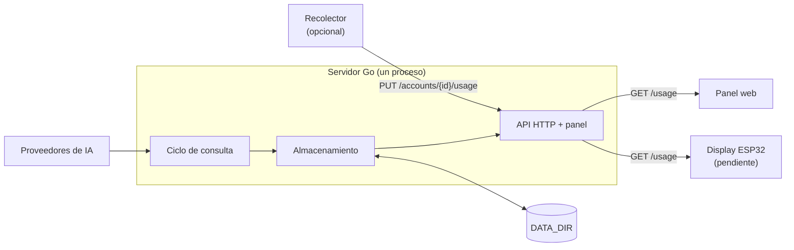

# Arquitectura y estructura del código

[English](architecture.md) · **Español**

## Componentes



Todo corre en un solo proceso, sin base de datos ni servicios auxiliares:

- **Ciclo de consulta**: al arrancar y cada `POLL_INTERVAL` recorre las cuentas `mock` y `direct` y pide los cupos a cada proveedor. También se dispara al completar un login de Codex o Claude y al guardar una credencial desde el panel. Corre en segundo plano, así que una caída de un proveedor no bloquea el arranque del servidor HTTP.
- **Almacenamiento**: guarda la última observación de cada cuenta. No hay historial.
- **API HTTP**: responde con lo guardado. Leer `GET /usage` nunca dispara una consulta a un proveedor.
- **Panel web**: HTML, CSS y Alpine.js embebidos en el binario y servidos en `/`. No hay paso de build ni proceso aparte.

## Estado de una cuenta

`GET /usage` calcula el `status` de cada cuenta al responder:

| `status` | Cuándo |
|---|---|
| `ok` | Hay una observación reciente |
| `stale` | La observación es más vieja que `STALE_AFTER`, una ventana ya se renovó, o la última consulta falló y quedan datos anteriores |
| `auth_required` | Falta la credencial, fue rechazada o la sesión venció |
| `unavailable` | Nunca hubo una observación, o no se pudo guardar |

El nivel de uso (`usageLevel`) de cada cupo también se calcula al responder y no se guarda. Ver el [contrato](api.es.md#lectura) en la referencia de la API.

## Datos en disco

Todo vive en `DATA_DIR` (`server/data/` en local, el volumen `usage-data` en Docker):

| Ruta | Contenido |
|---|---|
| `usage.json` | Última observación de cada cuenta |
| `panel-sessions.json` | Hashes SHA-256 de los tokens de sesión del panel |
| `credentials.json` | Credenciales cargadas desde el panel, cifradas con `MASTER_KEY` |
| `codex/<id-de-cuenta>/` | Perfil y sesión de Codex de esa cuenta |
| `claude/<id-de-cuenta>/credentials.json` | Sesión de Claude de esa cuenta |

Los archivos JSON se escriben de forma atómica. El diseño asume una sola instancia: no ejecutes varias réplicas sobre la misma carpeta. Tratá la carpeta y sus backups como secretos.

## Estructura del repositorio

```text
.
├── compose.yaml              Servicio para Docker Compose
├── Makefile                  Comandos de compilación, pruebas y ejecución
├── docs/                     Documentación, capturas y colección de Postman
├── enclosure/                Carcasa (pendiente de diseño)
├── firmware/                 Firmware del ESP32 (pendiente)
└── server/
    ├── Dockerfile
    ├── .env.example
    ├── configs/              Archivos de cuentas y datos de ejemplo
    ├── cmd/
    │   ├── server/           Punto de entrada: configuración, ciclo de consulta y HTTP
    │   └── collector/        Recolector opcional de Codex
    └── internal/
        ├── config/           Carga y validación de cuentas y de .env
        ├── usage/            Modelo de cupos, validación y usageLevel
        ├── storage/          Persistencia de la última observación
        ├── httpapi/          Rutas, autenticación y traducción de nombres
        ├── panelauth/        Contraseña, sesiones y límite de intentos del panel
        ├── secrets/          Credenciales cifradas
        ├── providers/        Un paquete por proveedor
        │   ├── openrouter/
        │   ├── codex/
        │   ├── cursor/
        │   └── claude/
        └── web/              Archivos estáticos del panel, embebidos
```

El servidor usa solo la biblioteca estándar de Go. El panel incluye Alpine.js localmente, en su build compatible con CSP; ver `server/internal/web/static/vendor/README.md`.

## Decisiones de diseño

- **Un contrato único**: todos los proveedores se convierten al mismo modelo de cupos (`usage.Report`), así el panel y el display no conocen detalles de cada servicio.
- **Solo lectura hacia los proveedores**: los clientes consultan cuentas y límites. No envían prompts ni consumen cupo.
- **Secretos fuera del navegador y del display**: las credenciales de proveedores quedan en el servidor; la API nunca las devuelve.
- **Tokens separados**: el display usa un token de solo lectura, distinto del token de administración y de la sesión del panel.

Para agregar un proveedor, ver [CONTRIBUTING](../CONTRIBUTING.es.md#agregar-un-proveedor).
