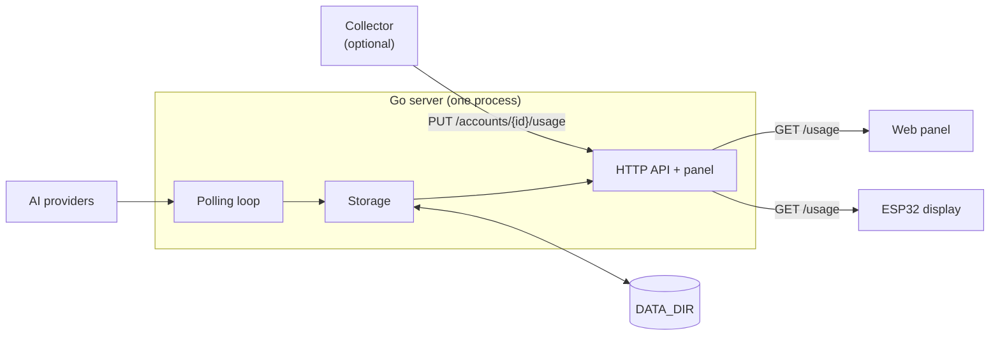

# Architecture and code structure

**English** · [Español](architecture.es.md)

## Components



Everything runs in a single process, with no database or auxiliary services:

- **Polling loop**: at startup and every `POLL_INTERVAL` it walks the `mock` and `direct` accounts and asks each provider for the quotas. It also runs when a Codex or Claude login completes and when a credential is saved from the panel. It runs in the background, so a provider outage does not block the HTTP server from starting.
- **Storage**: keeps the latest observation of each account. There is no history.
- **HTTP API**: answers with what is stored. Reading `GET /usage` never triggers a request to a provider.
- **Web panel**: HTML, CSS and Alpine.js embedded in the binary and served at `/`. There is no build step or separate process.

## Account status

`GET /usage` computes each account's `status` when it answers:

| `status` | When |
|---|---|
| `ok` | There is a recent observation |
| `stale` | The observation is older than `STALE_AFTER`, a window already reset, or the last poll failed and earlier data remains |
| `auth_required` | The credential is missing, was rejected, or the session expired |
| `unavailable` | There was never an observation, or it could not be stored |

Each quota's usage level (`usageLevel`) is also computed when answering and is not stored. See the [contract](api.md#reading) in the API reference.

## Data on disk

Everything lives in `DATA_DIR` (`server/data/` locally, the `usage-data` volume in Docker):

| Path | Contents |
|---|---|
| `usage.json` | Latest observation of each account |
| `panel-sessions.json` | SHA-256 hashes of the panel session tokens |
| `credentials.json` | Credentials loaded from the panel, encrypted with `MASTER_KEY` |
| `codex/<account-id>/` | Codex profile and session of that account |
| `claude/<account-id>/credentials.json` | Claude session of that account |

The JSON files are written atomically. The design assumes a single instance: do not run several replicas over the same folder. Treat the folder and its backups as secrets.

## Repository layout

```text
.
├── compose.yaml              Docker Compose service
├── Makefile                  Build, test and run commands
├── docs/                     Documentation, screenshots and Postman collection
├── enclosure/                3D-printable enclosure
├── firmware/                 ESP32 firmware
└── server/
    ├── Dockerfile
    ├── .env.example
    ├── configs/              Accounts files and example data
    ├── cmd/
    │   ├── server/           Entry point: configuration, polling loop and HTTP
    │   └── collector/        Optional Codex collector
    └── internal/
        ├── config/           Loading and validation of accounts and .env
        ├── usage/            Quota model, validation and usageLevel
        ├── storage/          Persistence of the latest observation
        ├── httpapi/          Routes, authentication and name translation
        ├── panelauth/        Panel password, sessions and login rate limit
        ├── secrets/          Encrypted credentials
        ├── providers/        One package per provider
        │   ├── openrouter/
        │   ├── codex/
        │   ├── cursor/
        │   └── claude/
        └── web/              Panel static files, embedded
```

The server uses only the Go standard library. The panel vendors Alpine.js locally, in its CSP-compatible build; see `server/internal/web/static/vendor/README.md`.

## Design decisions

- **A single contract**: every provider is converted to the same quota model (`usage.Report`), so the panel and the display know nothing about each service.
- **Read-only towards providers**: the clients query accounts and limits. They send no prompts and consume no quota.
- **Secrets stay out of the browser and the display**: provider credentials remain on the server; the API never returns them.
- **Separate tokens**: the display uses a read-only token, different from the administration token and from the panel session.

To add a provider, see [CONTRIBUTING](../CONTRIBUTING.md#adding-a-provider).
