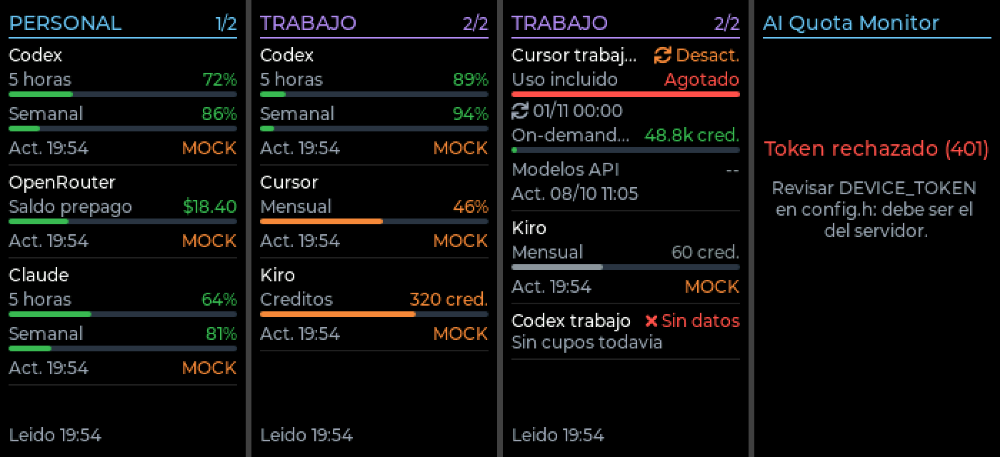

# Firmware and display

**English** · [Español](firmware.es.md)

Firmware for the **Waveshare ESP32-C6-LCD-1.47** (no touch). It connects to your Wi-Fi, reads `GET /usage` from your own server and shows the personal and work quotas, switching page every 10 seconds.

The sketch is in [`firmware/esp32-c6-lcd-1.47/ai_quota_monitor/`](../firmware/esp32-c6-lcd-1.47/ai_quota_monitor/).



The image is a render made on a computer with the firmware's drawing code and the mock API data. It is not a photo of the board.

## Verification status

| What | Status |
|---|---|
| Official Waveshare demo on the real board (compile, upload, screen on) | Tested |
| This firmware compiles for ESP32C6 Dev Module with the versions below | Verified (about 575 KB) |
| Parser and screen layout against real `GET /usage` responses, on a computer | Verified |
| This firmware on the physical board: screen, Wi-Fi, HTTP, HTTPS | **Not tested yet** |

## Versions

Use exactly these versions; do not mix them.

| Component | Version | Where it comes from |
|---|---|---|
| Arduino IDE | 2.3.10 | <https://www.arduino.cc/en/software> |
| esp32 by Espressif Systems | 3.3.12 | Boards Manager of the Arduino IDE |
| LVGL | 8.3.10 | `Arduino/libraries/lvgl` in the Waveshare demo ZIP |
| ArduinoJson | 7.4.3 | Library Manager of the Arduino IDE |

LVGL 9 does not work with this board's demo or with this firmware. PNGdec 1.0.2 is also in the ZIP; the official demo may need it, this firmware does not.

Official sources:

- Board documentation: <https://www.waveshare.com/wiki/ESP32-C6-LCD-1.47>
- Official demo: <https://files.waveshare.com/wiki/ESP32-C6-LCD-1.47/ESP32-C6-LCD-1.47-Demo.zip>
- ESP32 boards index for Arduino: <https://espressif.github.io/arduino-esp32/package_esp32_index.json>

## Step by step

No previous experience with Arduino is needed. Do the steps in order: steps 1 to 11 light up the screen with the manufacturer's demo, which proves that the board, the cable and the tools work before you add Wi-Fi and the API.

### 1. Hardware and cable

- A Waveshare ESP32-C6-LCD-1.47 board (not the S3 and not the Touch version). This is the board the project was developed on; see [where to buy it](hardware.md#board-used-and-where-to-buy-it).
- A USB-C **data** cable. Many cables only charge: with those the board turns on but the computer never detects it.

The screen is built into the board. There is nothing to wire and no microSD is needed.

### 2. Downloads

Download these two things:

- Arduino IDE, from <https://www.arduino.cc/en/software>.
- The official demo ZIP, from <https://files.waveshare.com/wiki/ESP32-C6-LCD-1.47/ESP32-C6-LCD-1.47-Demo.zip> (about 60 MB).

### 3. Install Arduino IDE

Install it like any other program and open it once.

### 4. Install the ESP32 boards

1. Open **Tools → Board → Boards Manager**.
2. Search for `esp32`.
3. In **esp32 by Espressif Systems**, choose version **3.3.12** and press **Install**. It takes several minutes.

If `esp32` does not appear, open the Arduino IDE **Preferences** (Settings), paste this address in **Additional boards manager URLs** and try again:

```text
https://espressif.github.io/arduino-esp32/package_esp32_index.json
```

### 5. Extract the demo

Extract the ZIP anywhere. The paths below are relative to its content:

- `Arduino/examples/LVGL_Arduino/`: the reference example.
- `Arduino/libraries/`: the libraries, `lvgl` and `PNGdec`.

### 6. Install the libraries

The LVGL library must be the one in the ZIP: it includes `src/lv_conf.h`, already configured for this board.

1. Open the Arduino IDE **Preferences**.
2. Look at the **Sketchbook location**.
3. Open that folder and create a `libraries` folder inside if it does not exist.
4. Copy the whole `lvgl` and `PNGdec` folders from `Arduino/libraries/` of the ZIP into that `libraries` folder.
5. Close and reopen Arduino IDE.

If the Arduino IDE later offers to update LVGL, decline: version 9 does not work here.

Then install the JSON parser, which is not in the ZIP:

1. Open **Tools → Manage Libraries**.
2. Search for `ArduinoJson` (by Benoit Blanchon).
3. Choose version **7.4.3** and press **Install**.

### 7. Open the official demo

Open **File → Open** and choose `Arduino/examples/LVGL_Arduino/LVGL_Arduino.ino` from the extracted ZIP.

### 8. Choose the board and the port

1. Connect the board with the USB-C cable.
2. **Tools → Board → esp32 → ESP32C6 Dev Module**.
3. **Tools → Port**: choose the port that appears when you plug the board in. Its name depends on your system; unplug and plug the board to see which one it is.

### 9. Choose the partition scheme

**Tools → Partition Scheme → Huge APP (3MB No OTA/1MB SPIFFS)**.

Without it the demo does not fit in the board's memory.

### 10. Verify and upload

The two buttons at the top left do different things:

- **✓ Verify** only compiles. It checks that the program and the libraries are fine, and it does not touch the board.
- **→ Upload** compiles and then writes the program to the board.

Press **✓ Verify** first. The first time takes several minutes. When it finishes without errors, press **→ Upload**.

### 11. Confirm the upload

The upload finished correctly when the output panel at the bottom shows these two lines:

```text
Hash of data verified.
Hard resetting via RTS pin...
```

The board restarts by itself and the screen shows the manufacturer's demo. If it does, the board, the cable and the tools work.

### 12. Open this project's sketch

Get the repository (with `git clone`, or **Code → Download ZIP** on the repository page) and, in Arduino IDE, open:

```text
firmware/esp32-c6-lcd-1.47/ai_quota_monitor/ai_quota_monitor.ino
```

The folder and the `.ino` file must keep the same name. Do not move the `.ino` out of its folder: the files next to it are part of the program.

### 13. Configure Wi-Fi, API and token

1. In `firmware/esp32-c6-lcd-1.47/ai_quota_monitor/`, copy `config.example.h` to a new file called `config.h` in that same folder.
2. Open `config.h` and fill in the values. Arduino IDE shows it as a tab once it exists; reopen the sketch if it does not.

| Setting | What to put |
|---|---|
| `WIFI_SSID` | Name of your Wi-Fi network. It must be 2.4 GHz |
| `WIFI_PASSWORD` | Its password |
| `API_BASE_URL` | Address of **your** server: `http://IP_OR_HOSTNAME:PORT`, without a trailing slash |
| `DEVICE_TOKEN` | The `DEVICE_TOKEN` of that server |
| `UI_LANGUAGE` | `"es"` or `"en"` |
| `API_TIMEZONE` | IANA time zone for the times on screen, for example `Europe/Madrid` |
| `API_CA_CERT` | Only for a private certificate authority with `https://`; see [HTTPS](#https) |
| `DISPLAY_BRIGHTNESS` | 0 to 100. The manufacturer recommends 50 or lower |

`API_BASE_URL` points to wherever you deployed the server: the IP and port are those of your own installation, not a fixed value. Two examples:

- Server started with `make docker-up` on a computer at `192.168.1.50`, with `HOST_BIND=0.0.0.0`: `http://192.168.1.50:8080`.
- Server deployed with `compose.coolify.yaml`, which publishes port 8090: `http://IP_OF_THE_SERVER:8090`.

**`localhost` does not work.** On the ESP32, `localhost` and `127.0.0.1` mean the ESP32 itself, not your computer. Use the LAN IP or the hostname of the machine that runs the server.

`config.h` is ignored by Git. Only the read token goes on the board: never put provider keys, Codex or Claude sessions, `COLLECTOR_TOKEN` or the panel password in it.

### 14. Run the API and reach it from the LAN

The server must be running and accept connections from the network, not only from itself. See [deployment](deployment.md): with Docker Compose that means setting `HOST_BIND` to the server's LAN IP or `0.0.0.0`.

Before uploading, check from **another** device on the same network that the address answers. Replace the address and the token with yours:

```sh
curl http://IP_OR_HOSTNAME:PORT/ping

curl -H 'Authorization: Bearer YOUR_DEVICE_TOKEN' \
  http://IP_OR_HOSTNAME:PORT/usage
```

The first one must answer `{"status":"ok"}` and the second one a JSON with `accounts`. If they do not work from another computer, they will not work from the board either.

### 15. Upload and expected result

With the same board, port and partition scheme as in steps 8 and 9, press **✓ Verify** and then **→ Upload**. Wait for `Hash of data verified.` and `Hard resetting via RTS pin...`.

What the screen shows:

1. For a few seconds, **No Wi-Fi** while it connects.
2. Then the **PERSONAL** page in light blue, and 10 seconds later the **WORK** page in violet. They keep alternating. If the accounts of a group do not fit, that group uses more pages and the top right shows which one, for example `2/3`. A group without accounts is skipped.
3. For each account: its name, each quota with what is left, a bar with the usage, the reset time when there is one, and the last update of that account.
4. At the bottom, when the API was last read.

## What the screen shows

- **Colors** follow each quota's `usageLevel`: `low` green, `medium` orange, `high` red, `unknown` gray. The board does not compute percentages to choose them.
- **Value on the right**: what is left (`limit - used`), or `Exhausted`. With `used` but no `limit` it shows the amount used; with neither, `--`. Nothing is invented: OpenRouter is shown in USD with the values the API returns, without a monthly limit or reset.
- **Reset**: `↻ HH:MM`, or with the date when it is another day. Not shown when the API sends `null`.
- **Upd.**: when the provider was last observed (`updatedAt`). The bottom line is a different thing: when the board last read the API.
- **Account status**: `↻ Stale`, `⚠ Login` (`auth_required`) or `✕ No data` (`unavailable`), next to the name.
- **MOCK**: in orange, on accounts with `source: mock`. Those numbers are examples, not your real usage.
- **Read errors**: the last data stays on screen and the bottom line says why it could not be read (no Wi-Fi, API unreachable, token rejected, HTTP error). After 150 seconds without a good read, every account is marked as stale. The board retries on its own, waiting from 5 seconds up to 5 minutes between attempts.

Texts are drawn without accents ("Creditos", "dias"): the fonts included in LVGL have no accented letters.

The screen can hold 16 accounts and 48 quotas in total; anything beyond that is not shown.

## HTTPS

With an `https://` address the certificate is always validated; there is no option to skip it.

- Certificate from a public authority (Let's Encrypt and similar): leave `API_CA_CERT` empty. The authorities bundled with the ESP32 core are used.
- Private authority or self-signed certificate: paste the root certificate in PEM format in `API_CA_CERT`.

HTTPS needs the current date, which the board gets by NTP, so it needs Internet access. On a trusted home network, plain `http://` with the LAN IP is simpler.

## Troubleshooting

| Problem | Solution |
|---|---|
| `lv_conf.h: No such file or directory` | LVGL is missing or it is not the one from the ZIP. Check that the `lvgl` folder in `libraries` is version 8.3.10 and contains `src/lv_conf.h`. Delete any other LVGL and copy the whole folder from the ZIP again |
| Errors inside LVGL files, or `This firmware needs LVGL 8.3.10` | LVGL 9 is installed. Remove it and use the folder from the ZIP |
| `Sketch too big` / the program does not fit | Choose **Tools → Partition Scheme → Huge APP (3MB No OTA/1MB SPIFFS)** |
| `ArduinoJson.h: No such file or directory` | Install ArduinoJson 7.4.3 from **Tools → Manage Libraries** |
| `Missing config.h` | Copy `config.example.h` to `config.h` in the sketch folder (step 13) |
| The board **ESP32C6 Dev Module** is not in the list | Install **esp32 by Espressif Systems** 3.3.12 (step 4) |
| No port appears | Use a USB-C data cable and another USB port. If it still does not appear, hold **BOOT**, press and release **RESET**, release **BOOT**, and look at the port list again |
| The upload fails or stays at `Connecting...` | Put the board in download mode with **BOOT** and **RESET** as above, upload again and press **RESET** when it finishes |
| Was the upload successful? | Yes, if the output shows `Hash of data verified.` and `Hard resetting via RTS pin...` |
| Black screen after uploading | Check the board (ESP32C6 Dev Module) and the partition scheme, and press **RESET**. Upload the official demo again: if the demo does not show anything either, the problem is not this firmware. Check that `DISPLAY_BRIGHTNESS` is not 0 |
| The screen says **Not configured** | `WIFI_SSID`, `API_BASE_URL` or `DEVICE_TOKEN` is empty in `config.h`. Fill them in and upload again |
| It stays at **No Wi-Fi** | Check the network name and password (upper and lower case matter). The network must be 2.4 GHz: the board does not see 5 GHz networks |
| **localhost will not work** | `API_BASE_URL` uses `localhost` or `127.0.0.1`. Use the server's LAN IP or hostname |
| **API unreachable** | Wrong IP or port, server stopped, or the server only listens on itself: set `HOST_BIND` (see [deployment](deployment.md)). Repeat the `curl` of step 14 from another computer. With `https://`, also check the certificate |
| **Token rejected (401)** | `DEVICE_TOKEN` in `config.h` is not the server's. Copy it again, without spaces or quotes inside |
| **Invalid response** | The address answers, but it is not this API: check the port and that the URL has no extra path |
| Everything says **MOCK** | The server uses the example configuration. Set `CONFIG_NAME=config.live.json` on the server and connect your accounts; see [configuration](configuration.md) |
| An account shows **Login** or **No data** | It comes from the server, not from the board: that account needs its login or credential. See [connect providers](providers/connect.md) |

To read the board's messages, set **Tools → USB CDC On Boot → Enabled**, upload again and open **Tools → Serial Monitor** at 115200 baud. Passwords and tokens are never printed.

## How it is built

- `ai_quota_monitor.ino`: start-up and the drawing loop.
- `net.cpp`: Wi-Fi and the requests, in their own task, so the screen keeps refreshing during a request. Timeouts of 8 s to connect and 10 s to read.
- `usage_parser.cpp`: reads the `GET /usage` contract described in the [API reference](api.md).
- `ui.cpp`: pages and drawing with LVGL.
- `Display_ST7789.*`, `LVGL_Driver.*`: screen drivers adapted from the official Waveshare demo. See [`NOTICE.md`](../firmware/esp32-c6-lcd-1.47/ai_quota_monitor/NOTICE.md).

The server answers `GET /usage` from what it has stored; reading it from the board never triggers a request to a provider. The board reads every 60 seconds.

## Pending on hardware

- Run this firmware on the physical board and check colors, brightness and legibility.
- Test Wi-Fi reconnection and long runs.
- Test an `https://` address with a real certificate.
- Optional RGB LED for low balance: not implemented.
