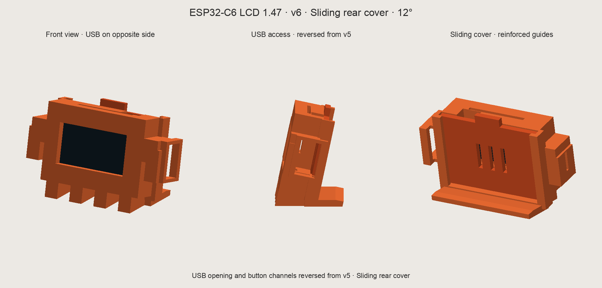

# Enclosure

**English** · [Español](README.es.md)



Desk enclosure for the [Waveshare ESP32-C6-LCD-1.47](../docs/hardware.md), version 3: two parts, horizontal screen tilted 12° backwards and a snap-fit lid, without screws. It goes with the [`ai_quota_monitor_horizontal`](../firmware/esp32-c6-lcd-1.47/README.md) sketch.

Status: designed and printed on a Bambu Lab A1 mini. The image is a render produced by the model script, not a photo. Its labels and the file names are in Spanish.

## Files

| File | Purpose |
|---|---|
| [`stl/claude-esp32-v6.3mf`](stl/claude-esp32-v6.3mf) | Both parts together, to open in Bambu Studio or another slicer |
| [`stl/carcasa.stl`](stl/carcasa.stl) | Body: 66 × 39.5 × 28 mm |
| [`stl/tapa.stl`](stl/tapa.stl) | Back lid with the clips: 51 × 31 × 12 mm |
| [`source/generar_modelo.py`](source/generar_modelo.py) | Parametric model: generates the STL files, the preview and `validacion.json` |
| [`source/empaquetar.py`](source/empaquetar.py) | Builds the 3MF from the STL files |
| [`source/validacion.json`](source/validacion.json) | Measurements and geometric checks of the latest generation |

The STL files are in millimeters, at 100% scale.

## Design

- **Stand**: four legs and a rear foot that share the contact plane; the screen sits tilted 12°.
- **Lid**: two flexible tabs with a hook, printed as part of the lid. No screws or extra parts.
- **USB-C on the right**: 15 × 8.8 mm opening with a reinforced frame. The rear edge is 2.4 mm thick.
- **BOOT and RESET**: reachable from the top and the bottom, near the USB end.
- **RGB LED**: open windows in the walls; no diffusers are printed.
- **Ventilation**: three slots in the lid.
- **Board**: the module is taken as 36.37 × 20.32 × 7.60 mm, from the [Waveshare drawing](https://docs.waveshare.com/ESP32-C6-LCD-1.47), with 0.45 mm of clearance per side. The microSD slot is reachable with the lid off.

## Printing

1. Open `stl/claude-esp32-v6.3mf` in the slicer, as geometry. It contains only the body and the lid: choose printer, filament and profile.
2. Keep the scale at 100%.
3. The body prints with its front on the bed; the lid, with its flat outer face on the bed.
4. Check the bridges of the USB opening and the small ramps of the hooks in the sliced preview.
5. Avoid supports that join or damage the tabs.

The enclosure was printed on a **Bambu Lab A1 mini**; the 3MF was opened and edited in **Bambu Studio** before printing. The material, layer height and profile used are not documented yet.

## Assembly

1. Try it without the cable first: seat the module in the cavity with the USB-C port on the right, without pressing the screen glass.
2. Align the lid and press gently until both clips engage. If it needs force, take it off and check the clearance and the finish of the tabs.
3. Plug in the cable and check that it does not push the module out of place.

To open it, press both tabs toward the center through the top and bottom windows, and pull the side grip of the lid backwards.

## Regenerating the model

```sh
pip install manifold3d numpy trimesh matplotlib pillow
python3 enclosure/source/generar_modelo.py
python3 enclosure/source/empaquetar.py
```

The first script rewrites `stl/carcasa.stl`, `stl/tapa.stl`, `preview.png` and `source/validacion.json`; the second one, `stl/claude-esp32-v6.3mf`. The preview uses the macOS Arial font.

## What was verified

- Geometry: each part is a closed solid, and Bambu Studio recognizes two valid solids in the 3MF.
- No interference between body, lid, module and a 12 × 6 mm reference cable in the closed position.
- The hooks hold the lid, and the lid comes out by flexing each clip 0.6 mm.
- Legs and foot share the contact plane in the position of use.

These checks are geometric: they do not simulate stress or fatigue. The durability of the clips was not measured.
